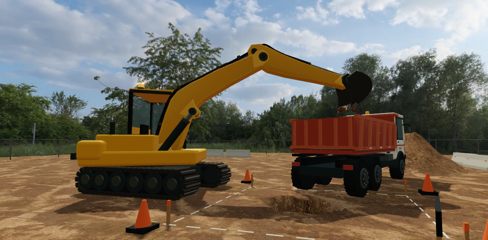

# Earthwork

Earthwork is a first-person construction simulator set in North Yard. Dig a trench with the excavator, haul the soil away in the dump truck, or take the forklift and stock the pallet bay.

**[Play Earthwork in your browser](https://gregwhitaker.github.io/earthwork/)**



## Your first haul

1. Start in the excavator's **Dig** mode. Click a patch of ground within reach and press **Space** to scoop. A full bucket holds 0.5 m³.
2. Click the truck bed or select **Aim at truck bed**. Once the bucket is over the bed, press **Space** to empty it. Use **Return to dig area** for the next scoop. Four full buckets meet the 2.0 m³ target.
3. Press **V** to take the wheel of the dump truck. Drive to open ground and stop. Press **Space** to tip the soil into a spoil pile, then press it again to lower the bed before driving away.

Driving leaves marks in the dirt. The dump truck stamps wide chevrons, the forklift leaves narrow ribbed tracks, and the excavator presses in its steel treads. Digging or covering them with fresh soil clears the marks.

## Stock the pallet bay

The forklift starts with its forks under the water drums. Press **Space** to lift the pallet, drive it into the striped bay, then stop and press **Space** to set it down. For the form oil and bagged cement, approach from any side with the forks low. Use **Q / E** to match the spacing of the two openings and drive straight in.

## Controls

Choose a cab in the toolbar or press **V** to cycle through them. In the excavator, select **Dig** or **Drive**, or press **T** to switch. The on-screen controls also work with touch.

| Key | Excavator · Dig | Excavator · Drive | Dump truck | Forklift |
| --- | --- | --- | --- | --- |
| **W / S** | Raise / lower boom | Forward / reverse | Forward / reverse | Forward / reverse |
| **A / D** | Swing cab | Turn tracks, even in place | Steer | Steer |
| **Q / E** | Curl / open bucket | Swing cab independently | — | Narrow / spread forks |
| **↑ / ↓** | Extend / retract stick | — | — | Raise / lower forks |
| **Space** | Scoop / empty bucket | Enter Dig and use bucket | Tip / lower bed when stopped | Pick up / set down when stopped |

Drag to look around. **C** centers the view and, in excavator Drive mode, aligns the cab with the tracks. **H** opens the operator guide, **P** pauses, and **M** toggles sound. **F** or the toolbar's fullscreen button toggles fullscreen. **Esc** exits it.

## Run locally

With Node.js installed, run this command from the repository root.

```sh
npm start
```

Open [localhost:5173](http://localhost:5173). Three.js, textures, and fonts ship with the JavaScript source, so you can skip dependency installation and build steps.

## License

Earthwork's original code is licensed under the [Apache License 2.0](LICENSE). For bundled libraries, fonts, and images, see the [third-party credits and licenses](earthwork/dist/assets/credits.txt).
